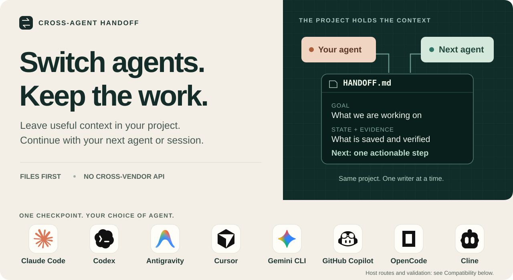
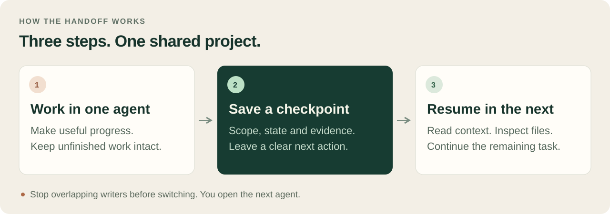
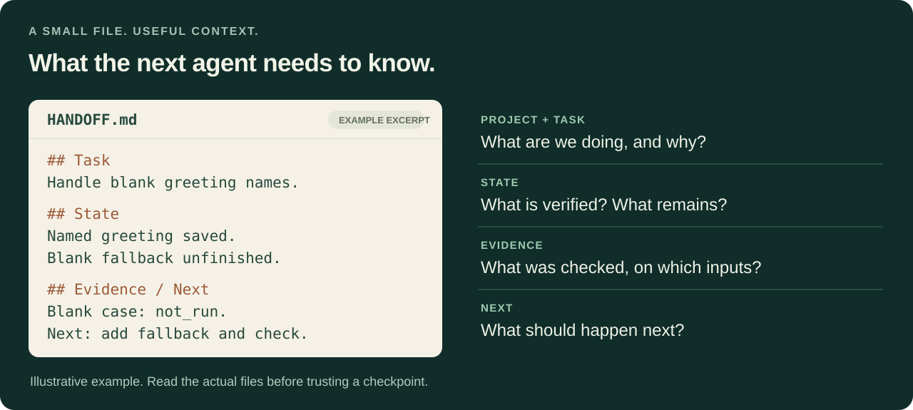

# Cross-Agent Handoff

<picture>
  <source media="(max-width: 600px)" srcset="docs/assets/readme-hero-mobile.svg">
  
</picture>

<p align="center">
  <a href="#quick-start">Quick start</a> ·
  <a href="#how-it-works">How it works</a> ·
  <a href="#compatibility">Compatibility</a> ·
  <a href="#documentation">Documentation</a>
</p>

[](https://github.com/kristianrolando/cross-agent-handoff/actions/workflows/ci.yml)
[](LICENSE)
[](https://github.com/kristianrolando/cross-agent-handoff/releases/tag/v0.1.1)

**Hit a usage limit? Switching agents? Returning in a new session?** Save the useful context in your project, then let the next agent inspect the files and continue.

Eight agent skill routes, one project checkpoint. [Compare compatibility and validation](#compatibility).

One compact checkpoint preserves the goal, verified progress, unfinished work, decisions, evidence and next action. No cross-vendor API calls, extra cloud service or shared chat history are required.

## Quick start

### Install your preferred route

**Claude Code plugin** · run inside Claude Code:

```text
/plugin marketplace add kristianrolando/cross-agent-handoff
/plugin install cross-agent-handoff@cross-agent-tools
```

**Direct skill for your coding agent** · run in your project:

```sh
npx skills add kristianrolando/cross-agent-handoff --skill cross-agent-handoff
```

Choose your host in the installer. For Antigravity, select **Antigravity** or append `--agent antigravity --copy` for a project-local copy. This installer requires Node.js 22.20+; the core workflow does not need Node.js. For manual copying and user-wide paths, see [installation options](#installation-options). Use one installation route per host. Check the [host guide](skills/cross-agent-handoff/references/agents.md) for locations and installer differences, including the recommended manual Cline path.

### Initialize once

| Your installation | Prompt |
| --- | --- |
| Claude Code plugin | `/cross-agent-handoff:cross-agent-handoff Initialize continuity in this project.` |
| Claude Code direct skill | `/cross-agent-handoff Initialize continuity in this project.` |
| Codex | `Use $cross-agent-handoff to initialize continuity in this project.` |
| Antigravity App, Cursor or Cline | `/cross-agent-handoff Initialize continuity in this project.` |
| Gemini CLI, GitHub Copilot or OpenCode | `Use the cross-agent-handoff skill to initialize continuity in this project.` |

If the host does not discover the skill, use the [explicit-file fallback](skills/cross-agent-handoff/references/agents.md#activate-and-route-project-context). Antigravity IDE discovery can be checked in Customizations; Gemini CLI exposes `/skills list`.

The agent inspects existing instructions and documentation, reuses a suitable checkpoint or creates `HANDOFF.md`, and adds short project routing where needed. For a new project, include your goal and acceptance criteria. Initialization does not scaffold an application or choose a stack.

## How it works

<picture>
  <source media="(max-width: 600px)" srcset="docs/assets/handoff-flow-mobile.svg">
  
</picture>

**Before switching**, ask the outgoing agent:

```text
Use cross-agent-handoff to save a handoff. Record actual progress, unfinished
work, evidence and limits, running operations, and one next action.
Start no new implementation.
```

Stop the outgoing session and any operations writing overlapping files. Open the **same project files** in the next agent:

```text
Use cross-agent-handoff to resume this project. Read the checkpoint and
applicable instructions, inspect actual files and changes, then continue
from the next supported action. Preserve unfinished work.
```

Use the same procedure for Claude → Antigravity, Antigravity → Codex, Cursor → Gemini CLI, or any other supported pair. You open the next host; the skill does not switch applications automatically.

## What survives the switch

<picture>
  <source media="(max-width: 600px)" srcset="docs/assets/checkpoint-map-mobile.svg">
  
</picture>

| Saved context | Why it matters |
| --- | --- |
| Goal, scope and acceptance criteria | Keep the task focused |
| Verified work and unfinished changes | Reuse progress without assuming completion |
| Decisions, failed attempts and blockers | Avoid rediscovering important findings |
| Checks, input identity and coverage limits | Know which evidence still applies |
| Writers, running operations and next action | Continue without overlapping edits |

The checkpoint links to existing requirements, architecture and backlog instead of becoming a second specification. See the [complete before/after example](docs/checkpoint-example.md) and [default template](skills/cross-agent-handoff/assets/checkpoint.md). The diagram is illustrative, not test evidence.

## Compatibility

| Host / component | Available route | Evidence and limits |
| --- | --- | --- |
| **Claude Code** | Direct skill or included Claude plugin | Maintainer reports successful use; manifests validated and installer copy checked. CLI 2.1.287 listed the project skill; the 2026-11-02 live trial could not run because its sign-in had expired. |
| **Codex** | Direct skill; optional UI metadata | Codex CLI 0.166 initialized, handed off and later finished a task in a [live trial](docs/evidence/live-trial-2026-11-02.md). |
| **Antigravity** | Native skill in `.agents/skills/` | Antigravity CLI 1.2.3 expanded `/cross-agent-handoff` and resumed from a Codex checkpoint in the [live trial](docs/evidence/live-trial-2026-11-02.md); headless mode denied shell commands, so it used file tools only. App and IDE not exercised. |
| **Cursor** | Native skill in `.agents/skills/`, `.cursor/skills/` or `.claude/skills/` | Official discovery/invocation documented; live-app handoff not exercised here. |
| **Gemini CLI** | Native skill in `.agents/skills/` or `.gemini/skills/` | Official discovery documented; activation consent/settings may apply; no live-app trial here. |
| **GitHub Copilot** | Native skill in `.github/skills/`, `.agents/skills/` or `.claude/skills/` | Official agent support documented; loaded when relevant, with no documented slash command; surfaces and locations vary; no live-app trial here. |
| **OpenCode** | Native skill in `.opencode/skills/` or `.agents/skills/` | Official skill-tool loading documented; permissions apply; no live-app trial here. |
| **Cline** | Native skill in `.cline/skills/` or `.claude/skills/` | Official discovery/slash invocation documented; `.agents/skills/` is not documented, so check the installer's destination; no live-app trial here. |
| **Windsurf / other filesystem agents** | Explicitly read installed `SKILL.md` and checkpoint | Portable fallback; native discovery not verified for this package. |
| Plain chat / uploads | Read supplied checkpoint and files | Snapshot only unless live filesystem tools are available. |
| Optional Python helper | Python 3.9+, standard library | Hosted checks passed on Linux, macOS and Windows. |
| Concurrent overlapping writers | Requires separate coordination | The sequential checkpoint does not lock source files. |

New host routes were checked against [official documentation and installation paths](skills/cross-agent-handoff/references/agents.md), reviewed on 2026-11-02. Documented compatibility, installer checks and actual model trials are distinct; only Codex and Antigravity CLI have a recorded live handoff. See [validation and coverage](docs/validation.md).

## What to expect

- **Project files carry context.** Applicable instructions and the inspected filesystem remain authoritative; the checkpoint guides the next inspection.
- **One writer at a time.** Stop overlapping source and output writers before handing over. Use separate areas/workspaces and an integrator for simultaneous work.
- **Save after every completed step.** Unsaved intent can be lost at a crash or usage limit. Optional snapshots and a resume-time check flag files changed after the last checkpoint, so the next agent knows to recover from the files. They are scripts started by the host or by you, not a background daemon, and they record what changed, not why.
- **Check the actual environment.** The core needs filesystem access. Git and Python are optional; the helper requires Python 3.9+.
- **Keep records with the work.** Moving devices requires transferring relevant dirty/untracked files and verifying the snapshot. No automatic cross-device synchronization is provided.

## Installation options

<details>
<summary><strong>Manual installation, locations and plugin loading</strong></summary>

Copy the complete `skills/cross-agent-handoff` directory, including LICENSE and supporting resources, to one supported location for each host.

The [host guide](skills/cross-agent-handoff/references/agents.md#install-the-complete-skill) lists project and user locations for all eight named native-skill hosts. No single project folder reaches every host: Claude Code and Cline do not read `.agents/skills/`, while Codex, Antigravity and Gemini CLI do not read `.claude/skills/`. Mixed teams may need two copies; keep every copy on the same version and use one canonical checkpoint.

Windows users can use their file manager; symlinks are not required. Inspect an existing installation before updating it rather than nesting a new copy inside its directory.

For local Claude plugin development, the marketplace command can point to this checkout. Root `AGENTS.md` and `CLAUDE.md` guide repository maintenance; installing the plugin does not automatically load those files into consumer projects. Initialization adds reviewed project routing when needed.

The included plugin wrapper is for Claude Code. Other hosts use direct skills or explicit file reading; this repository does not ship their native plugin wrappers.

</details>

<details>
<summary><strong>Automatic snapshots and opt-in hooks</strong></summary>

With Python 3.9+, `scripts/inject.py` prints resume context and warns when files or commits are newer than the checkpoint, which is what an abrupt stop leaves behind. `scripts/snapshot.py` records Git state, recently changed files and media metadata in a self-ignored `.handoff/auto/` folder.

Hooks can run these automatically in Claude Code, Codex and Antigravity. They are never installed by default: run `scripts/hooks.py install` yourself, review the printed change, and remove it the same way. Claude Code also snapshots when a turn ends with a rate-limit error. See the [hook guide](skills/cross-agent-handoff/references/hooks.md) for verified and unverified behavior per host.

</details>

<details>
<summary><strong>Recovery, health checks, updates and removal</strong></summary>

After an interruption:

```text
Use cross-agent-handoff to recover after interruption. Inspect the checkpoint,
actual files, relevant diffs and untracked work, available evidence and running
operations. Separate verified progress from unknown history, save reconciled
state, then continue the authorized task.
```

For a read-only health review:

```text
Use cross-agent-handoff to review continuity health without changing files.
Check routing, checkpoint claims versus files, validation inputs,
unfinished work and writer activity.
```

The [optional helper](skills/cross-agent-handoff/references/helper.md) provides draft creation, structural checks, selective file hashes, a previous copy and guarded atomic saves. It cannot prove historical test claims or writer inactivity.

To update, review and replace the installed skill while retaining project records. To remove, delete only the installation and reviewed routing additions; keep project data and decisions. See [setup and removal](skills/cross-agent-handoff/references/setup.md).

</details>

## Documentation

| Start here | Go deeper |
| --- | --- |
| [Checkpoint example](docs/checkpoint-example.md) | [Architecture and trade-offs](docs/architecture.md) |
| [Contributing with any coding agent](CONTRIBUTING.md) | [Validation evidence and limits](docs/validation.md) |
| [Setup and migration](skills/cross-agent-handoff/references/setup.md) | [File map](docs/file-map.md) |
| [Agent installation and activation](skills/cross-agent-handoff/references/agents.md) | [Release process](docs/releasing.md) |

## Checks and contributions

```sh
python3 -m unittest discover -s tests -v
```

Use `python` on systems where `python3` is unavailable. The [CI workflow](.github/workflows/ci.yml) checks pushes and pull requests without model calls or vendor credentials. The badge shows current status; [recorded evidence](docs/validation.md) separates automated checks, illustrative examples and live-use reports.

Human and AI-assisted contributions use the same instructions, checkpoint and review process. Start with [CONTRIBUTING.md](CONTRIBUTING.md). Visual assets in `docs/assets/` are editable SVG files with wide and narrow layouts, descriptive alternative text, no external fonts and no embedded scripts. Brand marks are embedded locally with [source credits and license](docs/assets/brand-credits.md).

## License

[MIT](LICENSE) · Copyright (c) 2026 Kristian Rolando Limantara.

The standalone skill bundles the same license. Preserve its notices when distributing copies or substantial portions. Following this workflow does not itself require changing a consumer project's license.
